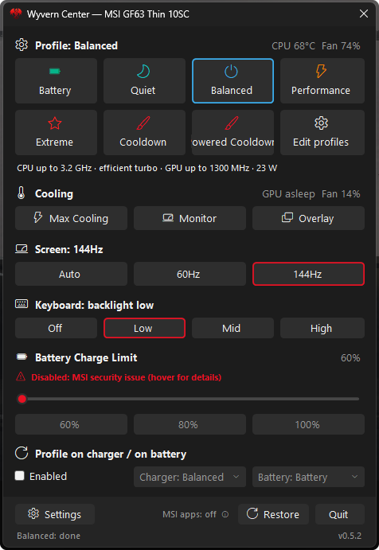
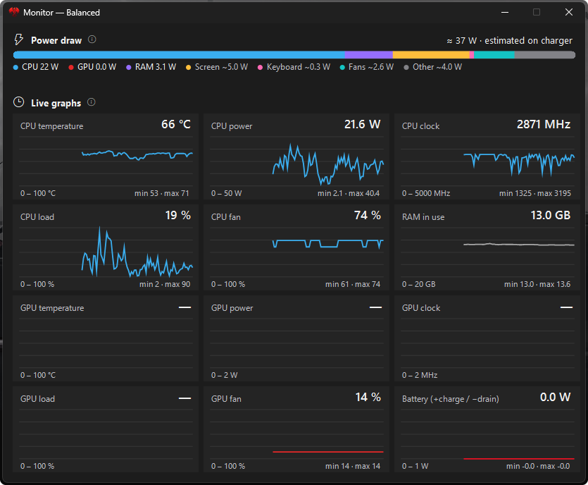
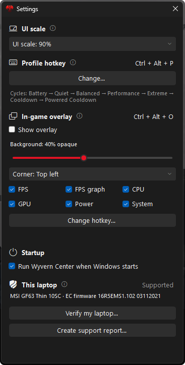
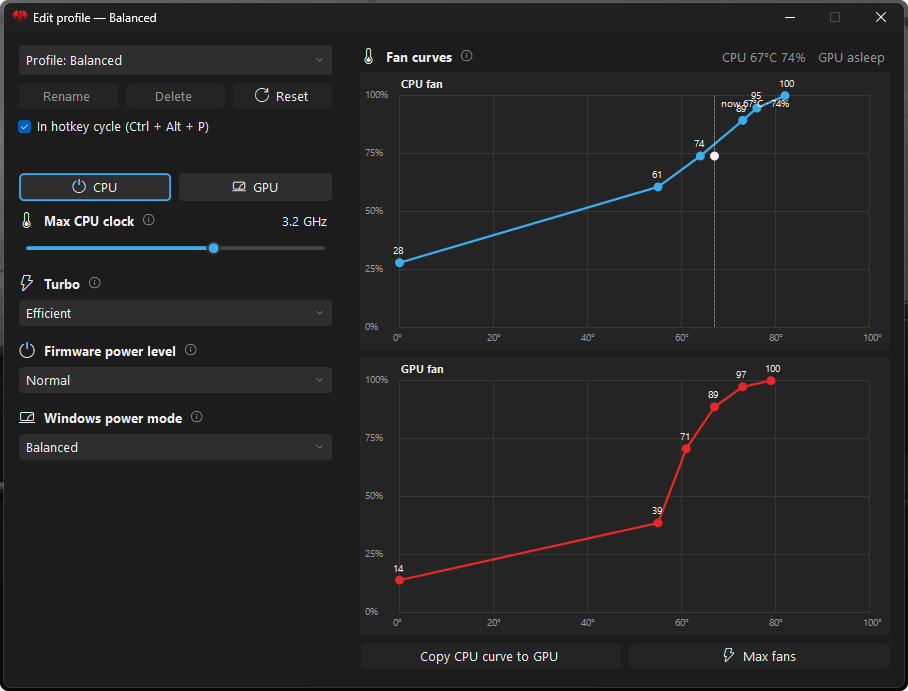
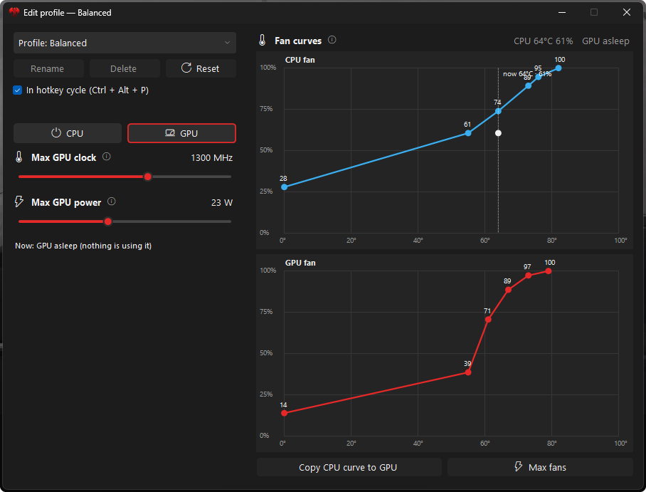

<p align="center"></p>

# Wyvern Center

A small, fast replacement for MSI Center on MSI laptops, in the spirit of [G-Helper](https://github.com/seerge/g-helper).
It lives in the tray, uses about 20 MB of RAM in the background, and installs no drivers or services.

> **Not affiliated with MSI.** "MSI" is a trademark of Micro-Star International. This is an independent, community
> project that talks to the laptop's firmware through interfaces already present in Windows.

## Screenshots

<p align="center">
  
</p>
<p align="center">
  
  &nbsp;
  
</p>
<p align="center">
  
  &nbsp;
  
</p>

## What it does

- **Profiles:** one click sets everything:
  - CPU clock cap and turbo behaviour;
  - MSI's firmware power level;
  - the Windows power mode;
  - both fan curves;
  - the NVIDIA GPU's clock cap and power limit.

  It ships with five presets (Battery, Quiet, Balanced, Performance, Extreme), and you can add up to two of your own.
  Presets scale to your CPU and GPU: clock caps are fractions of your CPU's base and top speed and your GPU's top
  clock, power caps a fraction of your GPU's limit, and fan curves are percentages.
- **Profile hotkey** (Ctrl + Alt + P by default): cycles through profiles, with a small popup.
- **Automatic switching** between a charger profile and a battery profile.
- **Fan curves:** drag the six points per fan, with a live marker showing where each fan is now.
- **Thermal failsafe:**
  - at 95 °C, both fans go to full speed;
  - your settings come back at 85 °C.

  On models in experimental mode, fan curves can't be set yet: the failsafe only moves Silent fan mode to the
  firmware's Auto mode.
- **In-game overlay** (Ctrl + Alt + O):
  - FPS with 1% low and frame time, plus a graph of the last minute;
  - CPU and GPU clock, load, watts, temperature and fan RPM;
  - power draw broken down by part;
  - RAM and battery.

  Each line can be switched on or off. You can adjust its opacity and corner, and clicks pass through it.
- **Monitor:** where the watts go (CPU, RAM, GPU, screen, keyboard, fans, other), and two-minute graphs of every reading.
- **Max Cooling:** all fans to full speed, like MSI's Cooler Boost, done through the firmware fan curves. Turning it
  off puts your fans back.
- **Other controls:** keyboard backlight and screen refresh rate (automatic on charger and battery).
- **Verify my laptop** (Settings → This laptop): a guided check for testers. Wyvern shows what it reads, you press a
  few keys, then it tries each setting for a few seconds and puts it back. The answers go into the support report.
- **Restore:** every original value is saved before Wyvern Center first changes it, and *Restore original settings* puts
  them all back.

## Supported laptops

| Laptop | EC firmware | Status |
|---|---|---|
| MSI GF63 Thin 10SC | `16R5EMS1.102` | Supported |

Other MSI laptops start in **read-only mode**: temperatures and fans are shown, nothing is written.
**Settings → This laptop** then offers two things:

- **Allow changes (experimental):**
  - Same board, different firmware version: uses that model's profile.
  - Any other MSI laptop: uses the generic profile. It covers only performance mode, fan mode and keyboard backlight,
    using MSI's standard encoding. Before each write it checks that the current value looks like that setting, and
    refuses if not. It never changes fan curves, battery limit or Cooler Boost, because those differ between models.

    Turning experimental mode off restores the original values first.
- **Create support report:** saves your laptop's firmware details (`report.md` and `dsdt.aml` in
  `C:\Program Files\Wyvern Center\data\reports\<model date>`). Attach them to a
  ["Support my laptop" issue](.github/ISSUE_TEMPLATE/new-model.yml), or email them to info@noptic.net, so the model can
  be added properly. See [docs/adding-a-model.md](docs/adding-a-model.md).

Non-MSI laptops aren't supported.

## Install

1. Download `WyvernCenter-<version>.zip` from [noptic.net/software](https://noptic.net/software) or the
   [Releases page](../../releases) and unzip it. Every release is built from this repository by GitHub Actions, with a
   SHA-256 checksum and a build attestation (`gh attestation verify WyvernCenter-<version>.zip -R redoninho/WyvernCenter`).
   The exe isn't code-signed yet, so SmartScreen asks first: **More info → Run anyway**.
2. Run it and accept the administrator prompt; firmware access needs admin rights.
3. Optional: **Settings → Startup**. This copies Wyvern Center to `C:\Program Files\Wyvern Center` and starts it at logon,
   without a UAC prompt.

Requirements: Windows 10 or 11 (64-bit). The .NET runtime is included in the exe.

Dragon Center and MSI Center can override fan and performance settings. The footer shows whether their services are
active; hover it to see which ones to set to Disabled. Wyvern Center never changes services itself.

## How it works

| What | How |
|---|---|
| Fans, performance mode, keyboard, sensors | The firmware's `SCM0` WMI data blocks (`MSI_System`, `MSI_CPU`, …), which map one-to-one onto EC registers. Read through MSI's `root\WMI` classes, or by firmware GUID when those aren't installed. No driver and no MSI software needed. |
| Newer laptops (11th gen and later) | The firmware's WMI v2 interface (`MSI_ACPI`), called by GUID. Read-only for now. |
| Max Cooling | Wyvern's Cooler Boost: both fan curves to full speed through the firmware, put back when turned off. |
| CPU clock and turbo | Windows power plan settings (`PROCFREQMAX`, `PERFBOOSTMODE`, …) and the Windows power mode. |
| GPU clock cap and power limit | NVIDIA NVML clock locks. The power limit is a software limiter that steps the clock cap. |
| FPS | A real-time ETW session on DXGI and Direct3D 9 present events. |

Safety rules the code follows:

- every setting is on a per-model whitelist with allowed values;
- every write is read back;
- the original values are snapshotted before the first write;
- a setting that fails once is not retried that session;
- the thermal failsafe runs on its own thread.

See [docs/research/gf63-thin-10sc.md](docs/research/gf63-thin-10sc.md) for how the firmware interface was mapped.

## Build

Needs the .NET 8 SDK on Windows.

```powershell
dotnet test                 # unit tests (no hardware needed)
.\publish.ps1               # self-contained single-file build -> dist\WyvernCenter.exe
```

A development build (`dotnet run --project src/WyvernCenter`) works, but it can't be installed for startup: an elevated logon
task must never run files from a user-writable folder.

Layout:
- `src/WyvernCenter.Core`: hardware access, safety, profiles and features (no UI).
- `src/WyvernCenter`: the WinForms tray app.
- `tests/`: unit tests.
- `tools/MsiProbe`: a read-only diagnostics tool used to map new models.

## Contributing

Contributions are welcome, especially new model profiles. See [CONTRIBUTING.md](CONTRIBUTING.md). Report security
issues privately: see [SECURITY.md](SECURITY.md).

## License

[GPL-3.0](LICENSE).
